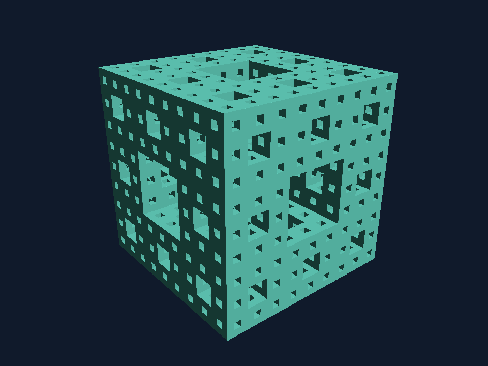
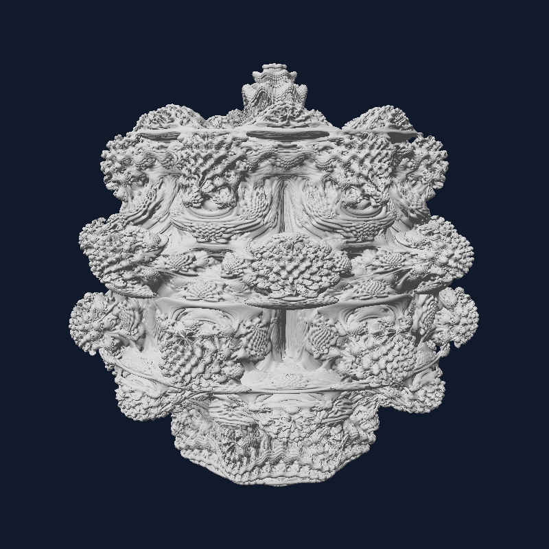

# CSCI 6221 — Clojure Ray Marcher

This repository contains the CPU ray-marcher final project. Language-evaluation slides, scripts, assignment materials, and examples are collected in the separate [Clojure folder](../clojure/README.md). The current MVP renders signed-distance scenes using CPU sphere tracing and displays the result in a desktop window or saves it as a PNG.

## Run the application

Install a JDK (17 or newer) and the Clojure CLI. From this repository's root:

```sh
clojure -M:run
```

The first run downloads Clojure and its dependencies. See the [launcher guide](docs/launcher.md) for the complete menu, PNG export, and settings behavior. Use `clojure -M:run --viewer` to skip the menu. A graphical launcher opens with scene selection, rendering/effects controls, and Advanced settings. Choose **Open viewer** to display the default orange sphere and cube with matte lighting on a dark background. The camera is at `(0, 0, 0)`, looks along **+X**, and sees a sphere centered at `(10, 0, -2)` with radius `2` and a cube centered at `(12, 0, 2)` with side length `3`. Coordinates are `[X Y Z]`, so Y is height and both centers have height zero. The camera uses +Y as up and a 60° vertical field of view. The surface normal is estimated from the scene distance field and shaded using one directional light plus a small ambient fill.

Image dimensions are configurable independently of the window size. The image scales to fit the window while keeping its aspect ratio; resizing the window does not change the render resolution.

```sh
clojure -M:run --width 1920 --height 1080
```

To save the same image without opening a window:

```sh
clojure -M:run --width 800 --height 450 --output preview.png
```

PNG exports show a live terminal progress bar with percentage and completed rows. Without an attached Java terminal console, progress is printed in occasional lines instead. Progress uses stderr; stdout retains the final saved-file message. At 100% of rows, a `Writing PNG...` message covers image encoding and saving. The percentage measures image rows, not estimated remaining time: detailed rows can take longer than background rows. No extra flag is needed, and interactive camera rendering stays unchanged.

The destination directory must already exist. Use `clojure -M:run --help` for options. This milestone does not impose a practical image-size cap; very large dimensions can exhaust memory.

## Multithreading

To render using multiple threads in a window, use

```sh
clojure -M:run --threads 16
```

PNG exports also accept `--threads N`. Both single-thread and multi-thread exports report completed-row progress. Uneven image heights and thread counts greater than image height are supported.

## Custom scenes

Load your own geometry, camera, lighting, and marching settings from a Clojure file:

```sh
clojure -M:run --scene scenes/example.clj
clojure -M:run --scene scenes/example.clj --lighting valve-half-lambert --output custom.png
```

See the [custom-scene tutorial](docs/custom-scenes.md) for a complete copyable example, coordinate conventions, object sizes, and how to define new distance functions. Scene files are ordinary executable Clojure. Without `--scene`, the built-in sphere-and-cube scene is used. A CLI lighting choice overrides the scene's model while preserving its other lighting settings.

## Floor and cast shadows

Select **Floor and shadows** in the launcher, then compare **Cast shadows → Off / Hard shadows**. Or run:

```sh
clojure -M:run --scene scenes/shadows.clj --shadows hard
clojure -M:run --scene scenes/shadows.clj --shadows off
```

A secondary ray toward the light tests for blockers. Shadows affect direct light; ambient fill and AO remain separate. Shadows are off by default outside scenes that enable them. See the [floor and shadows guide](docs/shadows.md) for configuration, the reusable floor function, and cyan shadow-budget diagnostics.

## Ambient occlusion

Use normal-direction distance probes to darken ambient light near contacts and crevices:

```sh
clojure -M:run --scene scenes/ao-demo.clj --ao normal
clojure -M:run --scene scenes/ao-demo.clj --ao only
clojure -M:run --scene scenes/ao-demo.clj --ao off
```

AO is off by default; the demo enables it. All modes also work for PNG export and threaded rendering. See the [AO guide](docs/ambient-occlusion.md) for sample/radius/strength settings, comparisons, and approximation limits. AO affects ambient fill; optional hard shadows affect direct light.

## Distance blending experiments

Try rounding the join between two spheres with either polynomial smooth minimum or exponential softmin:

```sh
clojure -M:run --scene scenes/blend-demo.clj --union hard
clojure -M:run --scene scenes/blend-demo.clj --union polynomial --blend 1
clojure -M:run --scene scenes/blend-demo.clj --union exponential --blend 1
```

Larger `--blend` values mean more blending; zero restores hard minimum. Both modes work with PNG export. The [distance-blending guide](docs/distance-blending.md) explains the formulas, reproducible comparisons, and how to expose an `:objects` group in your own scene. Existing `:scene-distance` scenes still load; CLI blending requires an explicit object group.

## Fractal scene

Explore a turquoise Menger sponge: a cube with repeating square tunnels, viewed from above and to one side. The scene is currently set to depth 5; the saved preview below shows depth 3.

```sh
clojure -M:run --scene scenes/menger.clj --width 960 --height 720
```



Edit `scenes/menger.clj` to change its camera, color, light, or the depth in `(fractals/menger-sponge [10 0 0] 6 5)`. The arguments are center, full side length, and subdivision depth. Depth 2 is lighter to render; depth 4 reveals smaller tunnels. Supported depths are 0–6, with 0 producing a solid cube. Finer detail needs tighter hit/normal tolerances and enough image resolution.

The function evaluates repeated tunnel cuts rather than enumerating individual cubes. It supplies a conservative distance bound; it is a finite approximation of the fractal. The saved preview has no AO or cast shadows; AO can now be enabled separately. More detail increases CPU cost. [Menger sponge construction reference](https://www.cs.utexas.edu/~fussell/courses/cs354/assignments/menger/handout.shtml).

## Mandelbulb scene

The supplied reference image appears to show a power-8 Mandelbulb. A separate pale-gray scene reproduces that fractal family and its upright, layered form:

```sh
clojure -M:run --scene scenes/mandelbulb.clj --width 800 --height 800
```



Its exact original parameters cannot be recovered from the image alone. This version uses spherical power 8, 14 escape iterations, a reduced marching step, and wider normal sampling to reduce speckled shading. The saved preview does not reproduce the reference's floor, soft shadows, or ambient occlusion. Optional AO can now be enabled, although this approximate fractal estimator needs careful tuning.

See [mandelbulb.md](docs/mandelbulb.md) for identification, tuning, and distance-estimator limitations.

## Camera controls

Focus the viewer window to use the keyboard. Hold the left mouse button and drag over the image to look around; release it to stop looking. No system pointer capture is required.

| Input | Action |
|---|---|
| W / S | Forward / backward along the horizontal XZ plane |
| A / D | Strafe left / right along that plane |
| Shift / Control | Move up / down along world Y |
| Left-button mouse drag | Turn and tilt the camera |
| R | Reset the selected scene's starting camera |
| Escape | Clear held movement and stop the current mouse drag |

Movement follows camera heading but stays horizontal even when looking up or down. Speed is 3 world units per second; diagonal movement has the same speed. Pitch is limited to ±89° to avoid flipping. Switching to another window clears held input. There is no collision detection: flying inside the sphere produces the marcher's existing immediate-hit behavior.

During movement the viewer requests previews with a maximum dimension of 240 pixels, scaled to fit the window. After 250 ms without camera changes it requests the configured full resolution. One background worker processes the latest pending view; previews may briefly lag the current camera, while obsolete full renders are cancelled. Actual refresh speed depends on scene cost and hardware; this is not a fixed-frame-rate renderer. The status line identifies preview/full resolution and the camera position used for the displayed image.

PNG export uses the selected scene's starting camera, without opening the interactive window.

## Lighting

The default is Lambert-style diffuse lighting with a small ambient fill. The world-space light direction points toward `[-0.6, 0.8, -0.5]`; the normal and light direction are unit vectors. Lighting is calculated in linear RGB and encoded to sRGB for display.

```sh
clojure -M:run --lighting lambert
clojure -M:run --lighting half-lambert
clojure -M:run --lighting valve-half-lambert
clojure -M:run --lighting flat
```

The alternative uses the proposed `clamp(dot(n,l)*0.5+0.5, 0, 1)` remap with the same ambient fill. The `valve-half-lambert` mode squares that remapped diffuse term before applying the same ambient fill. Flat mode preserves the earlier silhouette for comparison. Modes are selected at launch and also work with `--output`.

See [lighting.md](docs/lighting.md) for the formulas, normal estimation, differences between the models, and configurable lighting settings. Optional AO attenuates ambient fill; hard cast shadows are optional, while simulated light bounces remain future work.

## Project organization

- `src/ray_marcher/core.clj`: command-line parsing and launcher/viewer/export routing.
- `src/ray_marcher/launcher.clj`: menu actions, file dialogs, and background jobs.
- `src/ray_marcher/launcher_form.clj`: settings controls and form layout.
- `src/ray_marcher/configuration.clj`: shared CLI/menu configuration and validation.
- `src/ray_marcher/application.clj`: reusable viewer and PNG export actions.
- `src/ray_marcher/vector.clj`: basic 3D vector operations.
- `src/ray_marcher/scene.clj`: sphere, cube, box, and composable scene unions.
- `src/ray_marcher/blend.clj`: hard, polynomial, and stable exponential distance combiners.
- `scenes/blend-demo.clj`: fixed scene for distance-blending comparisons.
- `src/ray_marcher/fractals.clj`: Menger sponge distance bounds and Mandelbulb exterior estimates.
- `src/ray_marcher/scene_file.clj`: scene loading, validation, and camera preparation.
- `scenes/example.clj`: editable custom-scene example.
- `scenes/menger.clj`: framed and lit Menger sponge scene.
- `scenes/mandelbulb.clj`: pale-gray Mandelbulb matching the reference's fractal family.
- `src/ray_marcher/march.clj`: independent single-ray marcher.
- `src/ray_marcher/camera.clj`: perspective camera and pixel ray directions.
- `src/ray_marcher/render.clj`: sequential or parallel image rendering and row progress.
- `src/ray_marcher/lighting.clj`: distance-field normals, diffuse shading, and color conversion.
- `src/ray_marcher/ao.clj`: deterministic normal-sampled ambient occlusion.
- `src/ray_marcher/shadows.clj`: hard directional-light visibility using secondary rays.
- `scenes/shadows.clj`: sphere/cube floor scene with hard shadows.
- `scenes/ao-demo.clj`: sphere/cube contacts with a floor for AO comparisons.
- `src/ray_marcher/image.clj`: PNG output.
- `src/ray_marcher/progress.clj`: terminal progress reporting for PNG exports.
- `src/ray_marcher/controls.clj`: camera movement and mouse-look calculations.
- `src/ray_marcher/worker.clj`: background rendering with one pending view.
- `src/ray_marcher/ui.clj`: interactive Swing viewer and input handling.
- `docs/ray-marcher-requirements.md`: rough project requirements.
- `docs/development-diary.md`: dated progress, decisions, checks, and next steps for Rufat and William.
- `../clojure/`: language-evaluation materials and the final presentation.

The renderer creates a completed image that the existing window displays. The window does not contain scene, camera, ray, or lighting logic. The interactive window opens immediately and renders in the background. Completed images are published on Swing's event dispatch thread; the worker never modifies an image after publishing it.

## Marcher behavior and extension points

`ray-marcher.march/raymarch` accepts a scene distance function, ray origin `ro`, normalized ray direction `rd`, and optional settings. It checks the distance at the current point before advancing. Defaults are a `0.001` surface tolerance, `100` world-unit travel limit, and `128` distance evaluations per ray. Distances and tolerance are in world units.

Results distinguish `:hit`, `:miss` (travel limit), and `:step-limit` (unresolved). Hits include the position; all results include distance traveled/bounded and number of evaluations. Starting inside an object counts as an immediate hit. The marcher expects valid settings and a unit direction. Scene functions must return exact signed distances or safe distance bounds; arbitrary implicit equations are not automatically valid inputs.

The renderer casts one ray through each pixel center and accounts for image aspect ratio. Shaded orange means a hit, dark blue means a miss, and magenta means the step budget was exhausted. Near a silhouette, the finite surface tolerance can slightly expand the apparent shape. Image rows can render in parallel; there is no antialiasing or reflections yet; hard cast shadows are optional.

`render-image` accepts an optional map with `:scene-distance`, `:camera`, `:settings`, and `:color-fn`. Scene construction and camera setup happen independently of the marcher. The default lighting function uses the hit position and scene distance function to estimate an outward normal. Optional hard-shadow rays test directional-light visibility. An optional `:on-progress` callback receives `(completed-rows total-rows)` initially at zero and after each completed row. The renderer does not print progress itself. An optional `:cancelled?` predicate is checked between image rows; cancellation returns `nil`. The viewer uses this to abandon obsolete full-resolution frames. `:threads` selects parallel row tasks. Row ranges use integer boundaries and are collected in image order; progress reports total completed rows, and cancellation returns no partial image.

## Verification

```sh
clojure -M:test
```

Tests cover known sphere distances, a center hit at `(8, 0, 0)`, misses, travel and step limits, starting inside a sphere, camera directions, and image pixels checked against an independent analytic ray–sphere intersection calculation. Both portrait and landscape images and an off-center sphere are checked. Lighting tests check normals against known geometry, front/side/back illumination, ambient fill, color conversion, and the rendered light direction. Scene tests check box distances, the two-object default, file loading, validation, custom camera setup, and CLI lighting overrides. Additional tests check movement speed, horizontal travel while tilted, diagonal normalization, pitch limits, cancellation, and replacement of pending views. Tests require no graphical desktop.
