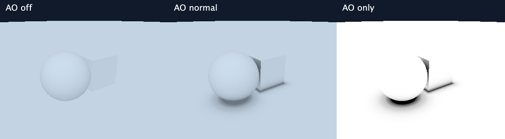

# Ambient occlusion

AO darkens places where nearby geometry reduces access to surrounding light, such as crevices and the contact between an object and a floor. It is separate from the directional light's cast shadows. This implementation estimates local crowding by sampling the scene distance along the outward surface normal; it does not trace the whole surrounding hemisphere.

## Use it

```sh
clojure -M:run --scene scenes/ao-demo.clj --ao off
clojure -M:run --scene scenes/ao-demo.clj --ao normal
clojure -M:run --scene scenes/ao-demo.clj --ao only
clojure -M:run --scene scenes/ao-demo.clj --ao normal --threads 2 --output ao.png
```



`off` disables the extra probes. `normal` applies AO to ambient lighting. `only` displays accessibility as grayscale: white is open, black is obscured. Background and magenta step-limit colors retain their usual meanings. Grayscale is encoded to sRGB, so a linear accessibility of 0.5 displays around byte 188, not 128.

The normal application default is **off** to preserve previous scenes. The demo explicitly enables AO and uses stronger ambient lighting to make its effect easy to see. `--ao` overrides only the mode, preserving the scene's sample settings. Without the flag the scene's choice is respected. All three diffuse models work with AO. `--lighting flat` or a custom `:color-fn` bypasses the shader entirely, including AO-only display.

Mode changes require restarting the viewer. Keep the scene, camera, resolution, lighting, and marching settings fixed to compare exports. No random samples are used, so results are reproducible and independent of thread scheduling.

## Configure a scene

Inside the existing scene `:lighting` map:

```clojure
:lighting {:ambient 0.4
           :diffuse-strength 0.6
           :ao {:mode :normal
                :samples 5
                :radius 1.0
                :bias 0.01
                :strength 1.0}}
```

All AO keys are optional. These are the default AO values except that the default mode is `:off`.

- `:samples`: integer 1–64; scene-distance probes per shaded hit. Five is the starting setting. More samples cost more, especially with fractals; changing the count also changes probe placement and weights, so it is not guaranteed to monotonically increase quality.
- `:radius`: positive finite world-space sampling span. Increase it to consider broader surroundings; reduce it for small details. The last sample is at `bias + radius` from the hit point. This is not a hard geometric cutoff: nearby surfaces to those probes can influence their distances.
- `:bias`: nonnegative finite addition to each probe's distance from the hit point. The first probe is at `bias + radius/samples`. This avoids sampling exactly at the hit point; it is not a correction for arbitrary inaccurate fields. Keep the first distance comfortably above hit tolerance and tune to scene scale.
- `:strength`: nonnegative finite multiplier on obscurance; 0 disables extra probes, 1 is the initial setting, higher values exaggerate darkening. Final accessibility is clamped to 0–1.

With the usual ambient value of 0.08, AO is intentionally subtle: it removes at most that ambient contribution, leaving direct lighting intact. Increase ambient and lower diffuse strength for an environment-lit look, or use `--ao only` to inspect geometry without the directional light.

## Calculation

For hit position `p`, unit normal `n`, sample count `N`, and zero-based sample index `i`:

```text
h_i = bias + radius * (i + 1) / N
q_i = p + n * h_i
deficit_i = clamp((h_i - sceneDistance(q_i)) / h_i, 0, 1)
weight_i = 0.5^i
accessibility = clamp(1 - strength * sum(weight_i * deficit_i) / sum(weight_i), 0, 1)
brightness = ambient * accessibility + diffuseStrength * diffuse
```

For an exact surface point on an isolated plane or sphere, moving outward by `h` gives scene distance `h`. Its deficit is zero, so it stays open. If another surface is nearer, the distance shrinks and the deficit grows. Nearby probes have more weight. The normalized deficits/weights are an implementation choice for a bounded, scale-aware obscurance estimate, not a claim to reproduce a physical visibility integral.

The underlying normal-distance comparison follows [Gerard's explanation and implementation](https://csh.rit.edu/~gman/PersonalWebpage/ao.html). Full AO measures the visibility of surrounding directions, as described in [GPU Gems, chapter 17](https://developer.nvidia.com/gpugems/gpugems/part-iii-materials/chapter-17-ambient-occlusion). This cheaper approximation uses only the normal direction, rather than hemisphere rays.

## Why not count the camera ray's steps?

Consider the exact distance field of a flat floor, `d([x,y,z]) = y`. A ray at height `y` whose unit direction has downward component `c` advances by `y`, leaving height `y * (1-c)`. A straight-down ray (`c=1`) reaches the floor immediately. A grazing ray (`c=0.01`) keeps 99% of its height after each step and needs many checks.

The automated counterexample starts at height 1 and uses tolerance 0.00001: the straight ray takes 2 distance checks, while the grazing ray takes over 1,000. Both surfaces are equally open and return accessibility 1. Step-count shading would darken the grazing view despite having no crevice. Tighter tolerance and conservative distance bounds can also raise counts without changing geometric visibility. Step counts remain useful for a future performance/debug view.

## Limits and verification

Normal-only probes miss directional blockers and can exaggerate proximity. For example, a wall behind the normal probes can reduce their distance even though it blocks only part of the hemisphere. A far plane lying outside the probes' nearest-distance region may have no influence even though full hemisphere visibility would detect it. There is no claim that this is exact AO.

Distance underestimation can look like occlusion even without additional geometry. Smooth unions and conservative fractal bounds can therefore exaggerate darkening. The Mandelbulb's approximate exterior estimator needs particular care: use AO-only mode and conservative strength before accepting the appearance as geometric evidence. Undefined zero normals return accessibility 1 to avoid inventing a direction.

Enabled AO adds exactly `samples` scene-distance evaluations per valid shaded hit, beyond the six normal evaluations; it adds none for misses, step-limit pixels, disabled AO, zero strength, or zero normals. Scene distance and AO settings are compiled into a pure per-image shader, outside Swing's event dispatch thread. No depth buffer, GPU pass, temporal history, extra primary-ray steps, or material blending is introduced.

Tests cover open planes and convex spheres, a known ceiling-distance result, closer blockers, bounds, probe counts, disabled/zero-normal behavior, the grazing-plane counterexample, direct-light preservation, AO-only pixels, CLI overrides, scene loading, and invalid settings. Full hemisphere sampling remains a possible later quality mode; cast shadows remain separate work.
