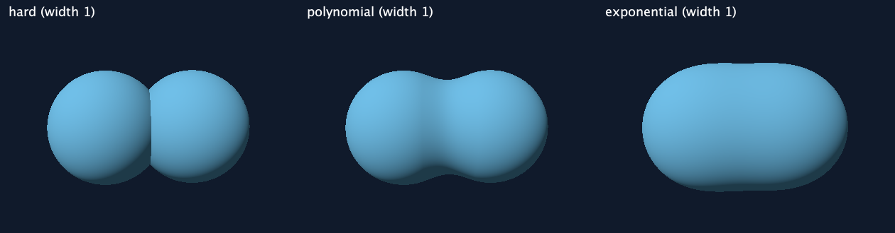

# Distance blending experiments

Normally a scene takes the smallest object distance. This joins overlapping solids but leaves a sharp crease where their surfaces meet. The experimental modes replace that minimum with a smooth minimum: the distance becomes slightly smaller around the join, making the solid swell and rounding the crease. Close objects can grow a bridge between them.

## Try the same scene three ways

Run from the project root:

```sh
clojure -M:run --scene scenes/blend-demo.clj --union hard
clojure -M:run --scene scenes/blend-demo.clj --union polynomial --blend 1
clojure -M:run --scene scenes/blend-demo.clj --union exponential --blend 1
```



The demo fixes two radius-2 spheres at `[10 0 -1.5]` and `[10 0 1.5]`, with the same camera and light. It starts in hard mode. `--blend` is a nonnegative width in world units: try `0.25`, `0.5`, `1`, and `2`. Larger means more blending in both modes. Zero gives exactly the ordinary minimum. Hard mode ignores width. Width defaults to 1 when the scene does not set it; `--blend` alone does not switch the mode.

Both flags work in the window and for PNG export:

```sh
clojure -M:run --scene scenes/blend-demo.clj --union hard --blend 1 --width 800 --height 600 --output hard.png
clojure -M:run --scene scenes/blend-demo.clj --union polynomial --blend 1 --width 800 --height 600 --output polynomial.png
clojure -M:run --scene scenes/blend-demo.clj --union exponential --blend 1 --width 800 --height 600 --output exponential.png
```

Keep scene contents, object order, width, camera, lighting, resolution, and marching settings fixed when comparing modes. Save the command alongside your image. Repeating an export with the same inputs produces the same pixels; moving the viewer camera changes the comparison. Mode selection is at startup; no live keyboard toggle or slider has been added.

## Make a custom scene configurable

Expose the objects instead of hiding them inside a completed union function:

```clojure
(ns scenes.my-blend
  (:require [ray-marcher.scene :as scene]))

{:objects [(scene/sphere [10 0 -1.5] 2)
           (scene/sphere [10 0 1.5] 2)]
 :union {:mode :polynomial :width 1.0}
 :camera {:position [0 3 -0.5] :look-at [10 0 0] :fov 40}
 :settings {:max-steps 256}}
```

`:objects` must be an ordered vector of distance functions. `:union` is optional; omitted values are `{:mode :hard :width 1.0}`. CLI flags override only the values supplied: `--union exponential` keeps the scene's width, and `--blend 0.5` keeps its mode. The built-in sphere-and-cube scene and `scenes/example.clj` also expose an object group, so they accept these flags.

The earlier `:scene-distance` format remains supported. Choose exactly one of `:objects` and `:scene-distance`. Union configuration on an opaque `:scene-distance` is rejected with an explanation, rather than pretending to change it. Convert `(scene/union a b)` into `:objects [a b]` to enable CLI experiments. A single fractal's internal calculations cannot be changed through this toggle.

For selective blending, build nested groups directly:

```clojure
:scene-distance
(scene/union
  (scene/blended-union {:mode :polynomial :width 1}
    (scene/sphere [10 0 -1.5] 2)
    (scene/sphere [10 0 1.5] 2))
  (scene/cube [16 0 0] 3))
```

This blends the two spheres and combines the cube with a hard minimum. To expose this whole group to the CLI, put its child functions in `:objects`; the override affects that outer group only. There is no global mutable mode and no replacement of minimum operations inside individual shapes.

## How the two modes work

Here `a` and `b` are distances and `k` is the positive blend width.

**Polynomial:**

```text
h = max(1 - abs(a - b) / k, 0)
result = min(a, b) - k * h² / 4
```

When the distances differ by at least `k`, the result is exactly the ordinary minimum. When they are equal, it subtracts `k/4`. This local influence makes polynomial blending a useful first choice when nearby joins should soften while distant parts stay unchanged. It uses basic arithmetic. Width is a transition parameter, not an exact fillet radius. The formulation is equivalent to the polynomial blend in [Alex Benton's Cambridge notes, slide 13](https://www.cl.cam.ac.uk/teaching/1819/FGraphics/1.%20Ray%20Marching%20and%20Signed%20Distance%20Fields.pdf).

**Exponential softmin:**

```text
result = -k * ln(exp(-a/k) + exp(-b/k))
```

This is the usual softmin with inverse sharpness `1/k`. We expose width rather than sharpness so increasing the same knob increases blending in either mode. It is evaluated in the equivalent stable form:

```text
m = min(a, b)
result = m - k * log1p(exp(-abs(a - b)/k))
```

The exponent is nonpositive, avoiding exponential overflow for large negative distances. At equal distances it subtracts `k * ln(2)`, about `0.693k`; that is more than polynomial's `0.25k`. Equal widths therefore do **not** mean equal visual strength. To match the equal-distance correction for two objects, start with exponential width about `0.36` times polynomial width. Their influence still differs away from the join. See the softmin formula and gradient discussion in [Rodolphe Vaillant's distance-field blending notes](https://rodolphe-vaillant.fr/entry/173/distance-field-composition-and-blending).

Exponential blending has no mathematical cutoff: distant objects still have a diminishing influence (eventually rounded away in floating point). Repeated binary softmin is equivalent to softmin over the whole group, apart from floating-point rounding. Identical copies count repeatedly: `n` equal distances subtract `k * ln(n)`. More objects can inflate the result more. There is deliberately no averaging by object count, which would change its relation to the hard minimum.

Polynomial blending folds left in vector order. It is symmetric for two inputs but **not associative**: rearranging three or more objects or nesting groups can change the surface. Preserve order and grouping for repeatable results. Exponential reduction can also differ very slightly with floating-point evaluation order.

## Rendering limits

Blending changes geometry, not just brightness. The marcher and normal calculation use the same compiled field, so diffuse lighting follows the rounded surface automatically. Materials still use a single scene-wide base color; this adds no material blending, shadows, or ambient occlusion.

The blended field is generally not an exact Euclidean distance. For exact 1-Lipschitz signed-distance inputs, both blends have nonnegative derivative weights summing to one, preserving the 1-Lipschitz bound needed for conservative exterior sphere-tracing steps. This does not make arbitrary implicit functions or approximate fractal estimators safe. Start with spheres and boxes. In particular, the Mandelbulb returns zero inside and an approximate exterior estimate: smoothing it is not a validated general signed-solid operation.

Blending can change step counts; exponential adds `exp`/`log1p` evaluations. No speed comparison has been measured. Increase `:max-steps` if rays turn magenta, and check hit tolerance/normal sampling if fine details disappear. Empty groups return positive infinity and single-object groups preserve that object unchanged in every mode.
