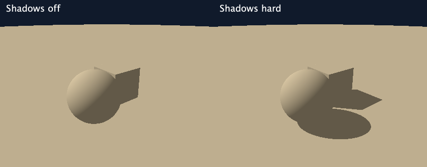

# Floor and hard shadows

The renderer can trace a second ray from a visible surface toward its directional light. A blocker removes direct illumination at that point. Ambient fill and AO remain independent, so shadows do not automatically become completely black.

## Try it

Select **Floor and shadows** in the graphical launcher, or run:

```sh
clojure -M:run --scene scenes/shadows.clj
clojure -M:run --scene scenes/shadows.clj --shadows off
clojure -M:run --scene scenes/shadows.clj --shadows hard --threads 3 --output shadows.png
```



The launcher has **Cast shadows → Off / Hard shadows** under Effects. **Advanced settings → Shadow tuning** exposes surface bias, shadow hit tolerance, travel limit, and step limit. Flat shading and AO-only display bypass shadows and disable those controls. Switching modes preserves the other shadow settings. CLI `--shadows off|hard` overrides only the scene's mode.

Shadows default to off to preserve existing scenes. The new demo enables them. It has a sphere and a cube resting on an infinite floor at Y = −2. All geometry currently shares the scene-wide material color. The demo light is positioned directionally so the cast shadows can be seen on the floor; its light direction is independent of the camera.

## How it works

For a camera-ray hit at `p`, unit outward normal `n`, and unit direction toward the light `l`:

```text
shadowOrigin = p + n * bias
shadowResult = raymarch(sceneDistance, shadowOrigin, l, shadowSettings)

hit        → blocked: direct visibility = 0
travel miss → clear within the configured range: direct visibility = 1
step limit → unresolved: show cyan diagnostic

brightness = ambient * AO + diffuseStrength * diffuse * directVisibility
```

Offsetting the origin prevents immediately re-hitting the same surface. A fixed directional light has no finite light position, so tracing stops at a configurable distance. Geometry beyond that range does not cast shadows through this query. Point lights are not implemented; a future point-light query would stop at the actual light distance.

The same signed-distance scene, including smooth joins, is used for primary rays, normals, AO, and shadows. The `shadows` module compiles a visibility function that reuses the independent single-ray marcher; it contains no shading or Swing code. Lighting uses the visibility result only when it has a positive direct contribution. Misses, flat/custom shading, AO-only display, zero normals, zero diffuse strength, and zero diffuse response cast no secondary ray. Off mode adds no extra scene-distance checks.

The two half-Lambert styles still calculate their existing wrapped diffuse response. Enabling geometric shadows can remove that response where the source is blocked, including by the object itself; they remain artistic models rather than physical diffuse reflection.

## Scene configuration

Add this inside the existing `:lighting` map:

```clojure
:shadows {:mode :hard
          :bias 0.01
          :epsilon 0.001
          :max-distance 100.0
          :max-steps 128}
```

These are the defaults except that the default mode is `:off`. Values are independent of the primary-ray settings.

- **Bias:** positive finite world-space offset along the normal, strictly greater than shadow epsilon. Too small can create false self-shadows; too large can detach shadows from contact points or skip thin nearby blockers. Increase carefully for approximate fractal fields or wider hit tolerances. The inequality alone does not guarantee artifact-free shadows on all geometry.
- **Epsilon:** positive finite shadow hit tolerance. Smaller values can preserve small gaps but need more marching steps. Tune alongside bias and scene scale.
- **Maximum distance:** positive finite shadow range from the offset origin. Increase it for larger scenes; distant blockers otherwise have no effect.
- **Maximum steps:** positive integer. Increase it when cyan pixels indicate unresolved shadow rays. The demo uses 256, while the default is 128.

**Cyan** means the shadow ray exhausted its step budget. **Magenta** still means the primary camera ray exhausted its budget. Neither is silently interpreted as a clear path. Grazing rays near planes or conservative distance bounds can require many steps even in simple scenes.

## Add a floor to another scene

The reusable constructor is:

```clojure
(scene/floor-plane -2)
```

It returns exact signed distance `y - floorHeight`: positive above the floor and negative in the solid half-space below. Flying below the floor invokes the marcher's existing immediate-inside-hit behavior.

Use a hard union between the floor and your object group:

```clojure
:scene-distance
(scene/union
  (scene/blended-union {:mode :polynomial :width 1.0}
    (scene/sphere [10 0 -2] 2)
    (scene/cube [12 -0.5 2] 3))
  (scene/floor-plane -2))
```

This rounds object joins without melting them into the ground. Because this is a completed `:scene-distance` function, the launcher's outer-group blending controls are unavailable; edit the nested group's settings in scene code. The floor is part of the scene, not a universal launcher checkbox. It has no independent material in this version.

## Limitations

These are sharp, binary shadows: no penumbra, area lights, transparency, reflections, or soft-shadow approximation. AO can soften local ambient contact shading but does not soften the directional-light shadow edge. Each eligible surface hit can add up to the shadow step budget in distance evaluations, which is expensive for fractals. No speedup or fixed-frame-rate claim is made.

Bias and finite hit tolerances introduce approximation. Conservative distance bounds may converge slowly, and the Mandelbulb exterior estimator is not a proven exact signed field. Use diagnostics and tune before relying on fine fractal shadow detail. Rendering stays off Swing's event dispatch thread; the existing cancellation mechanism checks between image rows, so costly shadow work can delay cancellation within a row.
